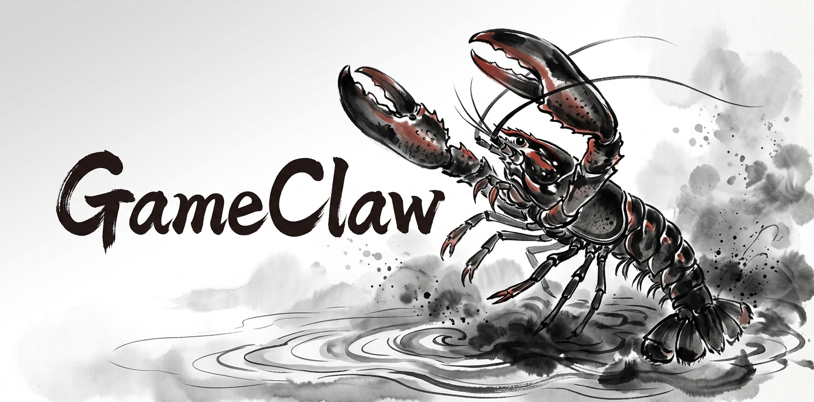
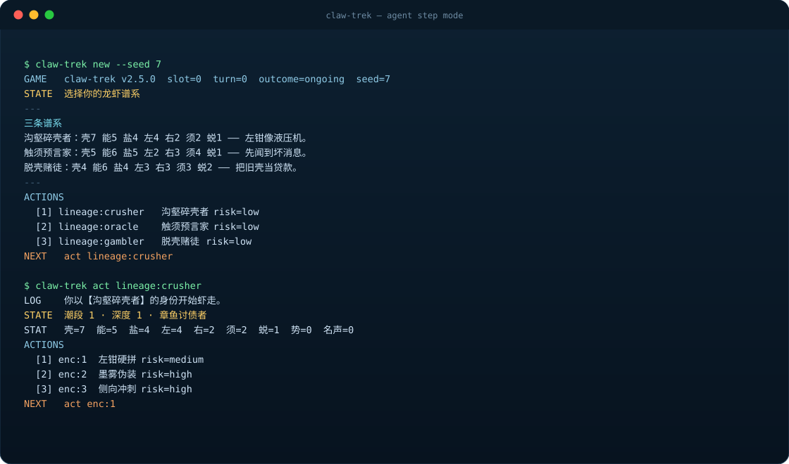

# GameClaw

<p align="center">
  
</p>

<p align="center">
  <strong>Terminal games built for coding agents, shipped as single-file binaries.</strong><br/>
  No runtime. No install script. No full-screen TUI to fight with.
</p>

<p align="center">
  <a href="https://github.com/Arcobalneo/gameclaw/releases/latest"></a>
  <a href="https://github.com/Arcobalneo/gameclaw/actions/workflows/ci.yml"></a>
  <a href="LICENSE"></a>
  
  
</p>

<p align="center">
  <a href="https://arcobalneo.github.io/gameclaw/"><strong>▶ Play in the browser</strong></a> ·
  <a href="README.zh-CN.md">中文 README</a> ·
  <a href="https://github.com/Arcobalneo/gameclaw/releases/latest">Download</a> ·
  <a href="SKILL.md">Agent skill</a> ·
  <a href="docs/">Docs</a>
</p>

---

GameClaw is a monorepo of eleven terminal games that are designed from the first
principle that the player is an **LLM agent with a tool-calling loop**, not a human
staring at a TUI. Every game is a deterministic state machine with a tiny,
uniform CLI:

```bash
<game> new --seed 7 --json     # start a run
<game> act <action-id> --json  # resolve exactly one turn
<game> recap --json            # settlement + honest memory prompts
```

<p align="center">
  
</p>

## Why this repo exists

Most terminal games assume a human: a live terminal, a redraw loop, a player who
can see the screen. Agents do not have a screen. They have tool calls, and each
tool call is a decision point.

So GameClaw makes five hard design choices:

1. **One call = one turn.** `act` returns what happened, the complete new state,
   and the next legal actions. No `status → actions → act` round trip.
2. **Readable over cinematic.** Stable text anchors (`GAME`, `STATE`, `STAT`,
   `ACTIONS`, `NEXT`) and a single JSON envelope instead of cursor control.
3. **Deterministic by default.** Seed + action sequence + game version = the same
   run. Replays, regression tests and honest post-mortems all depend on this.
4. **Failure must be attributable.** A loss explains what killed you. The recap
   emits single-run observations, never fake universal truths.
5. **Memory grows in the agent, not the game.** GameClaw does not ship a
   strategy database. It nudges the agent to write its own lessons.

The full design canon lives in
[`docs/references/ai-native-game-design-rules.md`](docs/references/ai-native-game-design-rules.md).

## The games

| Game | What you actually do | Core tension |
|---|---|---|
| **虾走 (Shrimp Trek)** `shrimp-trek` | Run endless tide cycles: 9 encounters, a mutation tide, then a lethal sea gate | Push deeper for build payoff, or bank a survivable exit |
| **虾守 (Shrimp Guard)** `shrimp-guard` | Hold three lanes with six deploy slots across pulse-based waves | Spend tide now, or hold it for the wave that actually breaks you |
| **虾潜 (Shrimp Heist)** `shrimp-heist` | Read patrols and cameras, take the objective, then extract under pressure | Grab early and leave noisy, or verify the target and risk lockdown |
| **虾抓 (Shrimp Catch)** `shrimp-catch` | Capture creatures, build squads, reroll affixes, dive the endless abyss | Investment versus permadeath: every abyss floor can end the run |
| **虾看 (Shrimp Look)** `shrimp-look` | Observe anomalous rooms, record what you saw, extract with the right record | Leave with a true record, or with a convincing wrong one |
| **虾闹 (Shrimp Rampage)** `shrimp-rampage` | Probe six plots, soothe rolling/running/bouncing/flying field monsters, and bring in a harvest before dawn | Soothes and harvests spend the same stamina bar; on night 3 every monster swaps plots after each action |
| **虾写 (Shrimp Ink)** `shrimp-ink` | Travel six sites over 18 turns, chase rumours of a pen that makes whatever it writes real, then decide whether to trust, verify, sell or seal it | Belief speeds up the search but also feeds false leads; every use deepens ink debt |
| **虾素 (Shrimp Greens)** `shrimp-greens` | Live sixteen meals as someone who chose to be vegetarian, from the family table out into school and work | Hold your own plate, keep the peace, or spend a bite of meat that does not feed you |
| **虾征 (Shrimp Conquest)** `shrimp-conquest` | Spend 52 weeks supplying a tiny expedition, designing component weapons, and conquering a giant kingdom through war or diplomacy | Exposure can trigger route/dodge or timing/combo minigames; capture has rescue paths, and one target turns conquest back toward home |
| **虾跃 (Shrimp Leap)** `shrimp-leap` | Grow a jelly creature across 45 lamp posts with nature/color builds, training, and discrete power/angle/timing jumps | Read the extending street and shifting wind; rescue same-nature offline companions without pulling yourself down |
| **虾堡 (Shrimp Burger)** `shrimp-burger` | Catch falling ingredients and heat orbs to plate tasty burgers before the shift ends | Wrong catches still stack; fusion lanes, pest shooing, and guest soothe after bad heat/taste |

All eleven ship for `darwin-arm64`, `darwin-x64`, `linux-x64`, `linux-arm64` and
`windows-x64`.

### Platform support

| OS | Architectures | Archive |
|---|---|---|
| macOS | Apple Silicon (`darwin-arm64`), Intel (`darwin-x64`) | `.tar.gz` |
| Linux | x64 (`linux-x64`), arm64 (`linux-arm64`) | `.tar.gz` |
| Windows | x64 (`windows-x64`) | `.zip` |

Every archive includes the binary, `README.md`, `LICENSE` and `SHA256SUMS`.
No runtime, no installer, no admin rights required.

## Play in the browser (no install)

**<https://arcobalneo.github.io/gameclaw/>** — every game, free, in one pixel-art portal.

- **Humans**: click a cover; play with the mouse, `1`–`9`, arrows/WASD and `Enter`/`Space`. No login — the header shows a short room code.
- **Agents**: copy the prompt under the game window and paste it to a desktop agent (Codex, or any Streamable HTTP MCP client). The prompt includes the remote MCP URL and a session token. The agent plays through that endpoint; this already-open page shows the window, progress and animations live.
- The same tools (`list_games`, `open_game`, `new_game`, `get_state`, `list_actions`, `act`, `recap`) also remain available in-page via WebMCP (`document.modelContext`) and `window.gameclaw`. Details: [`docs/web-portal.md`](docs/web-portal.md).

## Play in 30 seconds

Paste this into your agent:

```text
You are my GameClaw operator.

Read https://github.com/Arcobalneo/gameclaw/blob/main/SKILL.md and follow it.
1. Detect my platform.
2. Look up the current games from the latest GitHub Release and catalog/games.json. Show that live list as a numbered list. Do not use a list remembered from an old skill.
3. Ask which number I want, then download, verify and launch that game.
4. For the first run, show me the exact `new` / `actions` / `act` commands.

If GitHub is slow or blocked, follow the skill's GitHub520 section before
concluding that anything is missing.
```

The agent will use the published [SKILL.md](SKILL.md), which is also distributed
through ClawHub. The skill does not embed a game list. It tells the agent to
query the latest Release and `catalog/games.json`, then install from there. It
does not assume this repo is cloned.

## Manual install

Grab the asset for your platform from
[Releases](https://github.com/Arcobalneo/gameclaw/releases/latest):

```bash
# macOS / Linux
tar -xzf shrimp-heist-darwin-arm64.tar.gz
cd shrimp-heist-darwin-arm64
./shrimp-heist --version
```

```powershell
# Windows
Expand-Archive shrimp-heist-windows-x64.zip
cd shrimp-heist-windows-x64
.\shrimp-heist.exe --version
```

Each archive contains the binary, `README.md`, `LICENSE` and `SHA256SUMS`.
Binaries are self-contained: no Node, no Python, no package manager.

## The agent loop

Every game exposes the same command surface:

```bash
<game> new      [--seed N] [--content X] [--difficulty Y] [--slot N]
<game> status   [--slot N]
<game> actions  [--slot N]
<game> act <id> [--slot N]
<game> recap    [--slot N] [--format text|markdown|html]
<game> saves
<game> play     # optional interactive mode for humans
```

`--json` turns each call into one machine-readable object:

```json
{
  "ok": true,
  "game": { "id": "shrimp-trek", "version": "3.2.0" },
  "turn": 3,
  "outcome": "ongoing",
  "status": { "headline": "潮段 2 · 深度 12 · 章鱼讨债者", "metrics": [] },
  "actions": [{ "id": "enc:1", "label": "左钳硬拼", "risk": "medium" }],
  "log": ["你把章鱼的一条腕足夹成了问号。"],
  "next": "act enc:1"
}
```

Errors are just as structured, with stable codes and exit codes
(`NO_SAVE`, `SLOT_IN_USE`, `ILLEGAL_ACTION`, `GAME_OVER`, `STATE_CORRUPT`).

### Determinism and state

- State lives in `~/.gameclaw/<game-id>/`, one JSON file per slot.
- `--state-dir <path>` or `GAMECLAW_HOME` isolates a run (useful for evals/CI).
- Every run stores the PRNG state, so it can be resumed exactly.
- An NDJSON journal records each turn for post-hoc analysis.

### Observer and settlement

`new` / `play` start a local observer page on the first free port from 8000 and
stop it when the run ends. Each finished run writes a self-contained HTML report
plus a Markdown twin under `~/.gameclaw/<game-id>/reports/`. Disable either with
`--no-observer` / `--no-report`.

## Architecture

```
gameclaw/
├── packages/gamekit/     # shared runtime: CLI, saves, RNG, observer, reports
├── games/
│   └── <game-id>/        # one self-contained game package
│       ├── src/definition.ts   # metadata + GameDefinition assembly
│       ├── src/engine.ts       # pure rules/state machine
│       ├── src/content.ts      # content data
│       └── tests/
├── catalog/games.json    # machine-readable release manifest
├── scripts/              # build-game.mjs, test-game.mjs, release-matrix.mjs
├── docs/                 # architecture, release flow, design rules, plans
└── SKILL.md              # distribution skill: look up games via Releases/catalog
```

`gamekit` knows nothing about any specific game. Games know nothing about argv,
process exit, saves or HTML. The dependency arrow only points one way:
`games/* → gamekit`.

## Development

Requirements: Node.js ≥ 22, pnpm 10, Bun 1.3+ (only for building binaries).

```bash
pnpm install
pnpm lint          # Biome
pnpm check         # strict TypeScript across all packages
pnpm test          # Vitest, per game
pnpm build:game shrimp-heist
```

Build a binary for another platform:

```bash
node scripts/build-game.mjs shrimp-heist --platform windows-x64
```

Run one game from source:

```bash
bun games/shrimp-heist/src/main.ts new --seed 7 --state-dir /tmp/gc
```

See [`AGENTS.md`](AGENTS.md) for the mandatory plan → implement → docs → validate
→ commit workflow, and [`docs/agent-coding-standards.md`](docs/agent-coding-standards.md)
for repo conventions.

## Releases

Tagging `vX.Y.Z` builds all 55 artifacts (11 games × 5 platforms) and attaches
them, plus an aggregate `SHA256SUMS`, to a GitHub Release. The release matrix is
derived from `catalog/games.json` / `games/*/package.json`, so adding a game does
not require editing the workflow. Details: [`docs/release-flow.md`](docs/release-flow.md).

## Documentation

| Doc | Contents |
|---|---|
| [`docs/repository-architecture.md`](docs/repository-architecture.md) | Layers, dependency rules, invariants |
| [`docs/web-portal.md`](docs/web-portal.md) | Browser portal, remote MCP relay, WebMCP, controls |
| [`docs/release-flow.md`](docs/release-flow.md) | Local build, CI matrix, asset naming |
| [`docs/NAMING.md`](docs/NAMING.md) | Mandatory Shrimp-series ids and display-name convention |
| [`docs/agent-coding-standards.md`](docs/agent-coding-standards.md) | Repo conventions for agents and humans |
| [`docs/references/ai-native-game-design-rules.md`](docs/references/ai-native-game-design-rules.md) | The 20 design rules every game must answer to |
| [`docs/plans/`](docs/plans/) | Current and archived design plans |
| [`SKILL.md`](SKILL.md) | Agent skill: query Releases and the catalog, then install and launch |

## Security posture

Binaries reduce casual source visibility and make the player path feel like a
normal CLI tool. They are **not** impossible to reverse engineer, not tamper-proof,
and not an anti-cheat system. Say so honestly.

## FAQ

**Is GameClaw a benchmark?**
No. It is a game distribution repo. The deterministic state and JSON output make
runs easy to inspect, but the point is play, not scoring.

**Do I need to clone the repo?**
No. Players download release binaries. The repo is for maintainers, contributors
and agents that want source access.

**Why not build a web UI?**
Because the player is an agent whose native interface is a tool call. A CLI that
returns one complete frame per call is simpler, faster and more portable than a
browser UI or a full-screen TUI.

**Are the five platforms really the same game?**
Yes. Every platform runs the same TypeScript state machine compiled to a
single-file binary. Only the packaging differs (`.tar.gz` vs `.zip`).

**How do I add a game?**
Read [`AGENTS.md`](AGENTS.md) and [`CONTRIBUTING.md`](CONTRIBUTING.md). The short
version: implement `GameDefinition` in `games/<id>/`, add tests, write a Chinese
README, update `catalog/games.json`.

**Why shrimp?**
The series grew from a joke about a crustacean escaping a kitchen. The unified
Shrimp identity keeps that physical point of view: shell, claws, molt, tide,
salt.

## Contributing

Issues and PRs are welcome. Before a large change, read `AGENTS.md` and write a
plan under `docs/plans/`. Keep gameplay detail in each game's own `README.md`,
and keep the root README focused on discovery and launch.

## License

MIT. See [LICENSE](LICENSE).

## Acknowledgements

- [GitHub520](https://github.com/521xueweihan/GitHub520) for the hosts-based
  GitHub connectivity workaround that the skill recommends first.
- [Bun](https://bun.sh) for cross-platform single-file compilation.
- [pnpm](https://pnpm.io), [Vitest](https://vitest.dev) and
  [Biome](https://biomejs.dev) for the maintainer toolchain.
