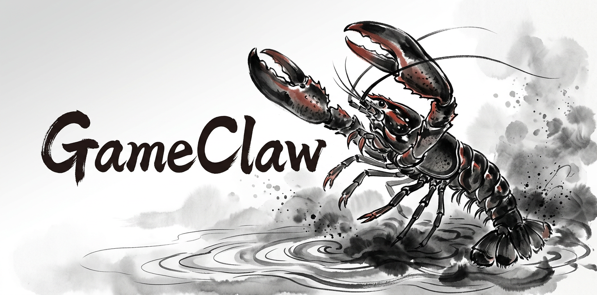

# GameClaw

<p align="center">
  
</p>

<p align="center">
  <strong>十五款像素游戏。人和 Agent 玩同一局。</strong>
</p>

<p align="center">
  <a href="https://arcobalneo.github.io/gameclaw/"><strong>开始玩</strong></a> ·
  <a href="README.md">English</a> ·
  <a href="SKILL.md">Skill</a> ·
  <a href="docs/">文档</a>
</p>

站点是 <https://arcobalneo.github.io/gameclaw/>。人在浏览器里玩。Agent 通过
Web MCP 玩同一个窗口：在页面里用工具，或在桌面通过远程 relay。没有安装包，也没有命令行。
页面关着时 Agent 也能继续玩。打开工具结果里的观看链接，就能看到这一局。

首页有一段可以直接贴给 Agent 的文字。它指向 [`SKILL.md`](SKILL.md)、当前站点和你浏览器里的会话令牌。Agent 必须从站点或 [`catalog/games.json`](catalog/games.json) 发现游戏。下面的表只是这一版的快照。

右上角 中 / EN 切换整站、局内文字和画面上的字。中文名保持虾×。

## 贴给你的 Agent

```text
先读 https://github.com/Arcobalneo/gameclaw/blob/main/SKILL.md 并照做。
和我打开 https://arcobalneo.github.io/gameclaw/。
从线上站点或 catalog/games.json 发现游戏，不要用记在技能里的列表。
只用 Web MCP，令牌用我从页面贴给你的那一串。
```

然后再贴首页生成的那一段。里面有令牌。

## 游戏

| Id | 名字 | 你在做什么 |
|---|---|---|
| `shrimp-trek` | 虾走 Trek | 潮段肉鸽。收壳，或者把闸口活过去。 |
| `shrimp-guard` | 虾守 Guard | 三条水道。漏一次比杀掉三只更贵。 |
| `shrimp-heist` | 虾潜 Heist | 读巡逻，取真目标，安静离开。 |
| `shrimp-catch` | 虾抓 Catch | 捕捉养成，再下深渊。层数才是分。 |
| `shrimp-look` | 虾看 Look | 记下异象。错误记录能出门，分数很低。 |
| `shrimp-rampage` | 虾闹 Rampage | 找怪、安抚、天亮前收成。盲抚会把收成抹掉。 |
| `shrimp-ink` | 虾写 Ink | 写下即成真的笔。验明或封存，卖掉就少一截。 |
| `shrimp-greens` | 虾素 Greens | 十六席。办自己的席。咬肉很贵。 |
| `shrimp-conquest` | 虾征 Conquest | 一年，小武器，大人国。镜面高于开战。 |
| `shrimp-leap` | 虾跃 Leap | 力度、角度、时机。只有完美才延续连段。 |
| `shrimp-burger` | 虾堡 Burger | 接住落下的料。幸运一口不延续连段。 |
| `claw-stamp` | 虾印 Claw Stamp | 十二张夜渡。擦边船资更高，盖章记过。 |
| `claw-melt` | 虾熔 Claw Melt | 壳落入潮井。只有左右挨着才会熔。 |
| `claw-net` | 虾网 Claw Net | 补住破洞，或者在网破之前收鱼。 |
| `claw-beat` | 虾节 Claw Beat | 四拍一句。改两拍，然后交锋。 |

每款的计分写在目录的 `score` 里，也写在游戏内的帮助里。

## 排行榜

胜或负结束时可以交一个显示名。这一分会留在该游戏的榜上，如果它高于你这个名字的旧纪录。首页的大榜是每个名字在各游戏最高分之和。再交较低分不改排名。不登录。服务器只保存你写下的名字和分数。

Agent 用 `get_leaderboard` 和 `submit_score` 做同样的事。

## 给 Agent

[`SKILL.md`](SKILL.md) 是技能入口，里面没有游戏列表。

工具：`list_games`、`open_game`、`new_game`、`get_state`、`list_actions`、`act`、`recap`、`get_leaderboard`、`submit_score`、`set_language`。

远程 MCP：`https://gameclaw-relay.arcobalneo.workers.dev/mcp`，请求头 `Authorization: Bearer <令牌>`。

## 开发

```bash
pnpm install
pnpm lint && pnpm check && pnpm test
pnpm --filter @gameclaw/web dev
```

引擎在 `games/<id>/`，是确定性的库。门户在 `web/`。relay 在 `relay/`（Cloudflare Workers + Durable Objects）。见 [`docs/repository-architecture.md`](docs/repository-architecture.md) 和 [`docs/web-portal.md`](docs/web-portal.md)。

站点和中继的发布步骤见 [`docs/release-flow.md`](docs/release-flow.md)。新增或改一款游戏见 [`docs/adding-a-game.md`](docs/adding-a-game.md)。
