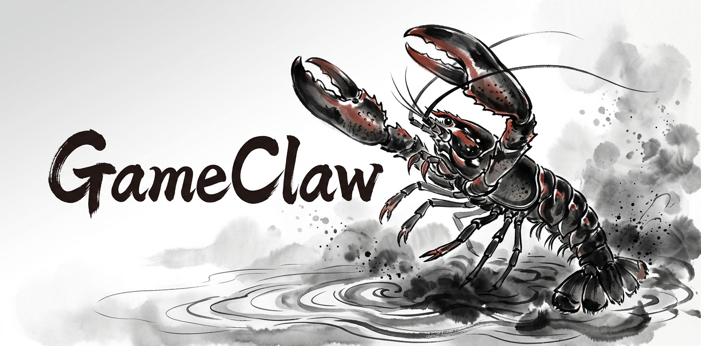
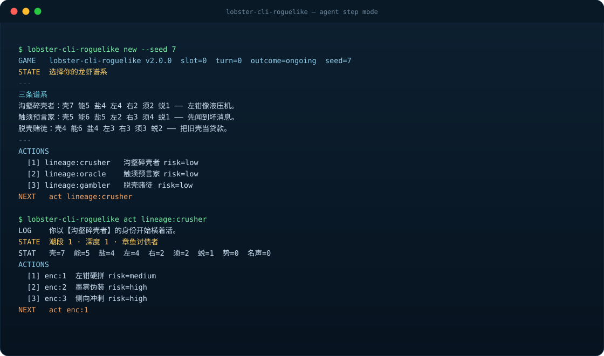

# GameClaw

<p align="center">
  
</p>

<p align="center">
  <strong>给 coding agent 玩的终端游戏，以单文件二进制发行。</strong><br/>
  不需要运行时，不需要安装脚本，也没有全屏 TUI 需要跟 agent 抢终端。
</p>

<p align="center">
  <a href="https://github.com/Arcobalneo/gameclaw/releases/latest"></a>
  <a href="https://github.com/Arcobalneo/gameclaw/actions/workflows/ci.yml"></a>
  <a href="LICENSE"></a>
  
  
</p>

<p align="center">
  <a href="README.md">English</a> ·
  <a href="https://github.com/Arcobalneo/gameclaw/releases/latest">下载</a> ·
  <a href="SKILL.md">Agent 技能</a> ·
  <a href="docs/">维护者文档</a>
</p>

---

GameClaw 是一个包含五款终端游戏的 monorepo。它的第一性原理只有一句：

> 玩家是一个**带工具调用循环的 LLM agent**，不是一个盯着 TUI 的人。

所以每款游戏都是一个确定性状态机，并且共享同一套极简 CLI：

```bash
<game> new --seed 7 --json     # 开一局
<game> act <action-id> --json  # 结算一个回合
<game> recap --json            # 结算页 + 诚实的 memory 引导
```

<p align="center">
  
</p>

## 为什么会有这个仓库

绝大多数终端游戏假设玩家有一块持续刷新的屏幕。Agent 没有屏幕，它只有工具调用；
而每一次工具调用，就是一个决策点。

因此 GameClaw 做了五个明确取舍：

1. **一次调用 = 一个回合。** `act` 返回本回合结果、完整新状态和下一步合法动作，
   不需要 `status → actions → act` 三次往返。
2. **可读优先于电影感。** 稳定的文本锚点（`GAME` / `STATE` / `STAT` /
   `ACTIONS` / `NEXT`）和单一 JSON 信封，取代光标控制与全屏重绘。
3. **默认确定性。** 同一个 seed + 同一串动作 + 同一个版本 = 完全相同的一局。
   回放、回归测试、可归因复盘都建立在这上面。
4. **失败必须可归因。** 输了要能说清输在哪。结算只输出“本局观察”，不把一次好运
   或一次暴毙伪装成普适规律。
5. **记忆长在 agent 身上，不在游戏里。** GameClaw 不内置策略数据库，只负责在关键
   节点推动 agent 把教训写进自己的 memory。

完整设计准则见
[`docs/references/ai-native-game-design-rules.md`](docs/references/ai-native-game-design-rules.md)。

## 五款游戏

| 游戏 | 你在做什么 | 核心张力 |
|---|---|---|
| **横着活** `lobster-cli-roguelike` | 无限潮段：9 场遭遇、1 次突变潮，然后是一道会死人的归海闸口 | 继续深潜拿 build，还是见好就收 |
| **横着守** `lobster-cli-tower-defense` | 三路防线、六个部署位、pulse 制波次 | 现在花潮令，还是留给真正会崩的那一波 |
| **横着潜** `lobster-cli-heist` | 读巡逻与摄像头，取目标，再在封锁前撤离 | 早拿早撤但噪音大，还是多验证但可能被锁死 |
| **横着抓** `lobster-cli-tamer` | 捕捉、编队、洗词条、下无尽深渊 | 投入养成，还是永久死亡的代价 |
| **横着看** `lobster-cli-sideways-look` | 单步观察异常房间、记录线索、带着记录撤离 | 带着真记录走，还是带着一份很像真的错记录走 |

五款游戏均提供 `darwin-arm64`、`darwin-x64`、`linux-x64`、`linux-arm64`、
`windows-x64` 五个平台的二进制。

### 平台支持

| 系统 | 架构 | 压缩格式 |
|---|---|---|
| macOS | Apple Silicon（`darwin-arm64`）、Intel（`darwin-x64`） | `.tar.gz` |
| Linux | x64（`linux-x64`）、arm64（`linux-arm64`） | `.tar.gz` |
| Windows | x64（`windows-x64`） | `.zip` |

每个压缩包内含二进制、`README.md`、`LICENSE` 与 `SHA256SUMS`。
不需要运行时、不需要安装器、不需要管理员权限。

## 30 秒开玩

把下面这段直接粘给你的 agent：

```text
你现在是我的 GameClaw 游戏操作员。

请阅读 https://github.com/Arcobalneo/gameclaw/blob/main/SKILL.md 并照做：
1. 自动判断我的平台。
2. 把五款 GameClaw 游戏作为编号列表展示给我。
3. 问我要玩第几个，然后下载、校验并启动对应游戏。
4. 第一局请直接给我 `new` / `actions` / `act` 的具体命令。

如果 GitHub 慢或连不上，先按技能里的 GitHub520 章节处理，不要直接下结论说资源不存在。
```

Agent 会使用已发布的 [SKILL.md](SKILL.md)。该技能是自包含的，不要求本仓库被克隆。

## 手动安装

从 [Releases](https://github.com/Arcobalneo/gameclaw/releases/latest) 下载对应平台的资产：

```bash
# macOS / Linux
tar -xzf lobster-cli-heist-darwin-arm64.tar.gz
cd lobster-cli-heist-darwin-arm64
./lobster-cli-heist --version
```

```powershell
# Windows
Expand-Archive lobster-cli-heist-windows-x64.zip
cd lobster-cli-heist-windows-x64
.\lobster-cli-heist.exe --version
```

每个压缩包内含二进制、`README.md`、`LICENSE` 与 `SHA256SUMS`。二进制自带运行时，
不需要 Node、Python 或包管理器。

## Agent 循环

所有游戏共享同一套命令：

```bash
<game> new      [--seed N] [--content X] [--difficulty Y] [--slot N]
<game> status   [--slot N]
<game> actions  [--slot N]
<game> act <id> [--slot N]
<game> recap    [--slot N] [--format text|markdown|html]
<game> saves
<game> play     # 可选的人类交互模式
```

加 `--json` 后，每次调用都只输出一个机器可读对象：

```json
{
  "ok": true,
  "game": { "id": "lobster-cli-roguelike", "version": "2.0.0" },
  "turn": 3,
  "outcome": "ongoing",
  "status": { "headline": "潮段 2 · 深度 12 · 章鱼讨债者", "metrics": [] },
  "actions": [{ "id": "enc:1", "label": "左钳硬拼", "risk": "medium" }],
  "log": ["你把章鱼的一条腕足夹成了问号。"],
  "next": "act enc:1"
}
```

错误同样是结构化的，带稳定错误码与退出码（`NO_SAVE`、`SLOT_IN_USE`、
`ILLEGAL_ACTION`、`GAME_OVER`、`STATE_CORRUPT`）。

### 确定性与存档

- 状态放在 `~/.gameclaw/<game-id>/`，一个槽位一个 JSON。
- `--state-dir <path>` 或 `GAMECLAW_HOME` 可以把一局隔离到沙箱目录，适合评测 / CI。
- 每局都保存 PRNG 状态，可以逐回合精确恢复。
- 每个回合写入 NDJSON 日志，便于事后分析。

### 旁观页与结算

`new` / `play` 会从 8000 起寻找空闲端口启动本地 observer 页面，局终自动停止。
每局结束会写一份自包含 HTML 结算页和一份 Markdown 版本，位于
`~/.gameclaw/<game-id>/reports/`。可用 `--no-observer` / `--no-report` 关闭。

## 架构

```
gameclaw/
├── packages/gamekit/     # 共享运行时：CLI、存档、RNG、observer、报告
├── games/
│   └── <game-id>/        # 每款游戏一个自包含包
│       ├── src/definition.ts   # 元数据 + GameDefinition 装配
│       ├── src/engine.ts       # 纯规则 / 状态机
│       ├── src/content.ts      # 内容数据
│       └── tests/
├── catalog/games.json    # 机器可读发行清单
├── scripts/              # build-game.mjs / test-game.mjs / release-matrix.mjs
├── docs/                 # 架构、发版、设计准则、计划归档
└── SKILL.md              # 自包含分发技能
```

`gamekit` 不认识任何具体游戏；游戏不接触 argv、进程退出、存档或 HTML。
依赖方向只有一个：`games/* → gamekit`。

## 本地开发

依赖：Node.js ≥ 22、pnpm 10、Bun 1.3+（仅编译二进制时需要）。

```bash
pnpm install
pnpm lint          # Biome
pnpm check         # 全仓严格 TypeScript
pnpm test          # Vitest，按游戏分跑
pnpm build:game lobster-cli-heist
```

交叉编译到其他平台：

```bash
node scripts/build-game.mjs lobster-cli-heist --platform windows-x64
```

从源码直接跑一款游戏：

```bash
bun games/lobster-cli-heist/src/main.ts new --seed 7 --state-dir /tmp/gc
```

强制的 plan → 实现 → 文档 → 验证 → 提交流程见 [`AGENTS.md`](AGENTS.md)，
仓库约定见 [`docs/agent-coding-standards.md`](docs/agent-coding-standards.md)。

## 发版

打 `vX.Y.Z` tag 会构建全部 25 个产物（5 款游戏 × 5 个平台），并连同聚合
`SHA256SUMS` 一起附到 GitHub Release。构建矩阵从 `games/*/package.json` 自动派生，
新增游戏不需要改 workflow。细节见 [`docs/release-flow.md`](docs/release-flow.md)。

## 文档

| 文档 | 内容 |
|---|---|
| [`docs/repository-architecture.md`](docs/repository-architecture.md) | 分层、依赖规则、仓库不变量 |
| [`docs/release-flow.md`](docs/release-flow.md) | 本地构建、CI 矩阵、资产命名 |
| [`docs/agent-coding-standards.md`](docs/agent-coding-standards.md) | 给 agent 与人的仓库规范 |
| [`docs/references/ai-native-game-design-rules.md`](docs/references/ai-native-game-design-rules.md) | 每款游戏都必须回答的 20 条设计准则 |
| [`docs/plans/`](docs/plans/) | 当前与归档的设计计划 |
| [`SKILL.md`](SKILL.md) | 可分发、自包含的 agent 技能 |

## 安全边界

二进制降低普通玩家直接翻源码的便利度，让玩家路径更像正常 CLI 工具。
它**不**保证不可逆向、不可篡改，也不是反作弊系统。请如实描述。

## 常见问题

**GameClaw 是 benchmark 吗？**
不是。它就是一个游戏发行仓库。确定性和 JSON 输出让每一局都容易检查，但目的是玩，不是打分。

**需要克隆仓库吗？**
不需要。玩家下载 Releases 二进制即可。仓库是给维护者、贡献者和想看源码的 agent 用的。

**为什么不做 Web UI？**
因为玩家是 agent，它原生的界面就是工具调用。一次调用返回一整帧的 CLI，比浏览器 UI 或全屏 TUI 更简单、更快、也更容易跨平台。

**五个平台是同一款游戏吗？**
是。每个平台跑的都是同一套 TypeScript 状态机编译出的单文件二进制，只有打包格式不同（`.tar.gz` 与 `.zip`）。

**怎么加一款新游戏？**
先读 [`AGENTS.md`](AGENTS.md) 和 [`CONTRIBUTING.md`](CONTRIBUTING.md)。简版：在 `games/<id>/` 实现 `GameDefinition`，补测试，写中文 README，更新 `catalog/games.json`。

**为什么是龙虾？**
第一款游戏本来只是“龙虾从厨房逃跑”的玩笑。主题留下来了，因为它给每个机制一个物理视角：壳、钳、蜕壳、潮、盐。

## 贡献

欢迎 issue 与 PR。大改动前请先读 `AGENTS.md`，在 `docs/plans/` 写计划；
游戏机制细节写在各游戏自己的 `README.md`，根 README 只负责发现与启动。

## 许可证

MIT，见 [LICENSE](LICENSE)。

## 致谢

- [GitHub520](https://github.com/521xueweihan/GitHub520)：技能中优先推荐的
  基于 hosts 的 GitHub 连接性修复方案。
- [Bun](https://bun.sh)：跨平台单文件编译。
- [pnpm](https://pnpm.io)、[Vitest](https://vitest.dev)、[Biome](https://biomejs.dev)：
  维护者工具链。
